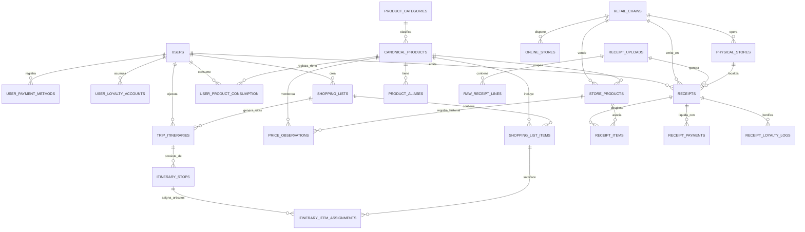
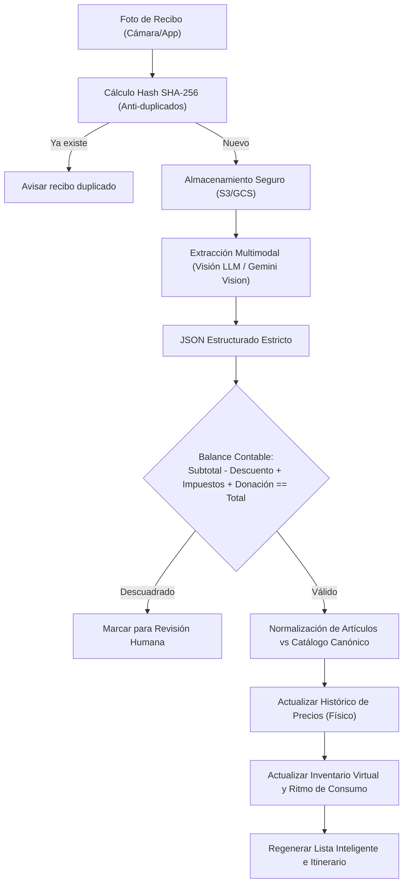

# Listio: Arquitectura de Base de Datos e Inteligencia de Compras Omnicanal

> **Documento de Diseño Técnico y Análisis Forense de Recibos**  
> **Proyecto:** Listio (Gestor Predictivo de Despensa e Itinerarios de Compra)  
> **Ubicación del Usuario:** San Nicolás de los Garza, Nuevo León, México  
> **Período de Análisis:** Marzo 2026 – Noviembre 2026 (75 recibos procesados)

---

## 1. Resumen Ejecutivo y Visión del Producto

**Listio** es una plataforma diseñada para resolver la ineficiencia en las compras de despensa del hogar. Mediante la digitalización e ingesta automatizada de fotografías de tickets de compra físicos y el monitoreo de catálogos y precios en tiendas en línea, Listio logra:

1. **Predecir la reposición de la despensa:** Estima el inventario virtual del hogar y genera listas de compra automáticas basadas en la velocidad de consumo real antes de que se agoten los artículos esenciales.
2. **Inteligencia de precios omnicanal:** Centraliza el histórico de precios observados en sucursales físicas y los precios actualizados de tiendas en línea preferidas (H-E-B, Soriana, Bodega Aurrera, Sam's Club).
3. **Optimizador de itinerarios y división de canasta (*Split-Cart Optimizer*):** Determina qué artículos comprar en qué tienda (física vs. digital con entrega a domicilio) balanceando el ahorro bruto contra el costo de traslado (distancia en km, gasolina y tiempo del usuario).

---

## 2. Arqueología de Datos: Análisis Forense de los 75 Recibos

A partir del procesamiento de los dos archivos PDF (`20261108_2-001.pdf` y `20261108_2-002.pdf`), se analizaron 75 páginas de tickets reales con diversas estructuras de emisión:

### 2.1 Cadenas Comerciales Identificadas
| Cadena / Comercio | Formato / Razón Social | Sucursales Clave | Características Distintivas del Ticket |
| :--- | :--- | :--- | :--- |
| **H-E-B** | Supermercados Internacionales H-E-B S.A. de C.V. | Terminales AutoCobro (671, 672, 673, 674, 675, 676) San Nicolás | Columnas: `ARTICULO`, `CANT.`, `PRE.UNIT`, `TOTAL`. Artículos a granel pesados en báscula de autocobro. Donaciones recurrentes (*Tratamientos y Cirugías*, *Educación Síndrome Down*, *Hambre Cero*). Tasas fiscales: IEPS 8%, IEPS 53% (licor), IVA 16%. |
| **Soriana Híper** | Tiendas Soriana S.A. de C.V. (RFC: `TS0991022PB6`) | Sucursal San Nicolás (12), Ave. Alfonso Reyes 601, Col. El Roble, CP 66450 | Columnas: `CANT`, `SKU`, `ARTICULO`, `PRECIO NORMAL`, `PRECIO PROMOCION`, `TOTAL`. Impresión de peso exacto (ej. `1.545 005 CHULETA`). Pago de artículos con Puntos Soriana YA (líneas con cantidad negativa). Detalle de monedero electrónico y puntos. |
| **Bodega Aurrera** | Nueva Wal Mart de México S. de R.L. de C.V. (RFC: `NWM9709244W4`) | Unidad Santo Domingo, Av. Sto. Domingo SN, CP 66430, San Nicolás | Agrupación por **departamento** (`QUESOS Y EMBUTIDOS`, `ABARROTES BASICOS`, `QUIMICOS`, `FRUTAS Y VERDURAS`, `PANADERIA`). Códigos EAN-13 de 13 dígitos y PLU de 5 dígitos. Promociones *Rebaja 1x$X* y *Combina 4x$X*. Pago mixto (Puntos BBVA + Tarjeta Crédito Bancomer). |
| **Sam's Club** | Nueva Wal Mart de México S. de R.L. de C.V. | Unidad Universidad Monterrey, Av. Universidad 413, Col. El Roble, CP 66500 | Formato mayorista (presentaciones de 2 kg, Member's Mark). Identificación de membresía: `SOCIO: *********3043 CAT: PLUS`. Recompensa acumulada 2%, cuponeras y descuento por pago con débito/efectivo (`Ajuste al cliente`). |
| **Avipecuaria Marlan** (*El Más Pollo*) | Avipecuaria Marlan S.A. de C.V. (RFC: `AML8910189F0`) | Sucursal Lampazos (Chapultepec) y Sucursal San Nicolás Centro (Arturo B. de la Garza 321) | Carnicería especializada de aves. Venta de pollo fresco al mayoreo por kilo (`MUSLO CON RABADILLA $43.90/kg`, `PIERNA Y MUSLO REY $49.90/kg`, `HUEVO $27.78/kg`). Ahorro sustancial frente a supermercados tradicionales. |
| **Tres Horacios** | Comercio local independiente | Mariano Matamoros 430, Col. Centro, San Nicolás, CP 66400 | Boutique de carnes y quesos artesanales (`Milanesa de pollo $260.00/kg`, `Lomo de cerdo $170.00/kg`, `Queso Asadero 500g`). Sistema POS moderno con folio alfanumérico y cobros divididos en dos tarjetas. |
| **OXXO** | Cadena Comercial OXXO S.A. de C.V. (RFC: `CCO-860523-1N4`) | Tienda Pino NLD, Arturo B. de la Garza #701, San Nicolás Centro, CP 66400 | Compras de conveniencia inmediata de abarrotes (`Harina Selecta 1kg`, `Maizena 160g`, `Maggi Soya`). Pago con tarjeta de débito Broxel. |

---

### 2.2 Patrones de Consumo del Usuario (*Yesser Caraballo Guzmán*)
1. **Canasta de Proteína Dividida:** La pierna y muslo de pollo se adquiere preferentemente en *El Más Pollo* a **\$43.90/kg** o en *Soriana* en días de oferta a **\$29.90/kg**, evitando pagar los **\$55.00–\$80.00/kg** de H-E-B. Para cortes gourmet o preparados rápidos acude a *Tres Horacios*.
2. **Volumen vs. Frescura:**
   - **Volumen / Congelados (Sam's Club):** Fresas congeladas bolsa 2 kg (\$163.68, \$81.84/kg), pimiento mix congelado, ajo pelado, queso Oaxaca Member's Mark.
   - **Frescos y Perecederos Diarios (H-E-B / Aurrera):** Plátano, limón agrio, tomate huaje, camote, papaya, aguacate, leche entera 1L y tortillas de maíz.
   - **Abarrotes y Limpieza Económica (Bodega Aurrera):** Detergente Roma (\$35.00), Jabón Zote (\$6.00-\$7.50), atún y sardinas enlatadas, sopas de pasta.
3. **Casos Límite y Complejidades Contables Detectadas en Recibos:**
   - **Líneas Canceladas:** Ítems escaneados y anulados en caja con saldo negativo (`***** LINEA # 21 CANCELADA ** 42.90-`).
   - **Pagos Divididos (*Split Payment*):** Liquidación de un ticket con dos tarjetas distintas (ej. H-E-B ticket de \$1,512.00 pagado con \$112.00 Contactless + \$1,400.00 Prosa; Tres Horacios \$450.00 + \$370.83).
   - **Puntos como Forma de Pago:** Bodega Aurrera con puntos BBVA (\$32.06 Puntos + \$75.83 Crédito); Soriana con líneas directas de artículos pagados con puntos Soriana YA.
   - **Micro-cargos y Donaciones:** Redondeo Medio Ambiente, Tratamientos y Cirugías, Unidos por Venezuela, Hambre Cero, Educación Síndrome Down (de \$0.04 a \$0.97).
   - **Variabilidad de Nomenclatura:** Un mismo producto canónico aparece con decenas de etiquetas diferentes:
     - Plátano: `PLATANO`, `PLATANO CHIA`, `PLATANO MACH`, `PLATANO KG`.
     - Tomate: `TOMATE HUAJE SUPREMO`, `TOMAT HUAJE`, `JITOMATE $45 KG`.
     - Pierna de Cerdo: `PIERNA DE CERDO C H REB`, `PIERNA DE CERDO SIN HUESO`, `PIERNA CERDO S/HUES`, `LOMO CERDO NATURAL`.

---

## 3. Diagrama Entidad-Relación (Mermaid ERD)



---

## 4. Arquitectura y Diccionario de Datos

La base de datos se estructura en 6 subsistemas modulares:

### 4.1 Ingesta de Fotos de Recibos y Visión
- `receipt_uploads`: Almacena el hash SHA-256 de la imagen (idempotencia y detección de duplicados), URI en storage (S3/GCS), metadata técnica, estado (`PENDING`, `EXTRACTED`, `VALIDATED`, `FAILED`) y el JSON crudo del modelo de visión.
- `raw_receipt_lines`: Líneas OCR sin procesar con bounding boxes y coordenadas espaciales `[ymin, xmin, ymax, xmax]` para habilitar interfaces de corrección rápida al usuario (*human-in-the-loop*).

### 4.2 Cadenas y Tiendas Omnicanal
- `retail_chains`: Cadenas comerciales (H-E-B, Soriana, Walmart/Aurrera, Sam's Club, El Más Pollo, Tres Horacios, Oxxo) con sus RFCs oficiales y categorías principales.
- `physical_stores`: Sucursales geolocalizadas (latitud/longitud, dirección, colonia, código postal, horarios y disponibilidad de autocobro).
- `online_stores`: Parámetros de las plataformas web/apps de cada cadena (costo de envío estándar, umbral de envío gratis, tiempo de entrega y tarifas de pickup).

### 4.3 Catálogo Canónico y Normalización
- `canonical_products`: Entidades maestras universales (ej. *Plátano Tabasco / Cavendish*, *Leche Entera 1L*, *Pierna y Muslo de Pollo*). Atributos clave: `standard_unit` (`kg`, `l`, `piece`), `estimated_shelf_life_days` (vida útil estimada) e indicador de perecedero.
- `store_products`: Mapeo específico de la tienda. Captura la cadena, el SKU o PLU local (`002`, `40112`, `980000690`), código de barras EAN-13, descripción textual exacta del ticket y factor de empaque (`pack_size_quantity`).
- `product_aliases`: Diccionario de sinónimos y variaciones textuales para emparejamiento difuso (*trigram matching* / embeddings).

### 4.4 Transacciones y Tickets Validados
- `receipts`: Cabecera de la transacción. Registra timestamp, sucursal, folio de ticket, subtotal, total de ahorros/descuentos, desglose impositivo (IVA, IEPS), donaciones/redondeos, total final y validación contable matemática (`is_mathematically_balanced`).
- `receipt_items`: Líneas individuales de compra con cantidad, precio unitario regular, precio promocional, descuento específico de la línea, impuesto y bandera de anulación (`is_cancelled`).
- `receipt_payments`: Soporte nativo para pagos múltiples (*split payment*), asociando tarjetas bancarias (VISA, Mastercard, Prosa), efectivo o puntos BBVA.
- `receipt_loyalty_logs`: Auditoría de beneficios de lealtad (Puntos Soriana YA ganados o redimidos, dinero electrónico, recompensa 2% Sam's Plus).

### 4.5 Inteligencia de Precios y Seguimiento Omnicanal
- `price_observations`: Precios normalizados a unidad estándar (`normalized_price_per_std_unit` en \$/kg, \$/L o \$/pza), registrando el canal de origen (`IN_STORE_RECEIPT` vs. `ONLINE_CATALOG`), fecha de observación y mecánica de promoción (*Descuento directo*, *2x1*, *3x20*, *Precio con puntos*).

### 4.6 Motor Predictivo e Itinerarios de Compra
- `user_product_consumption`: Registro del comportamiento de consumo del hogar: intervalo medio de reorden en días ($\Delta t$), consumo diario ($\text{tasa}$), última fecha de compra, inventario virtual restante y fecha estimada de agotamiento.
- `shopping_lists` y `shopping_list_items`: Listas de despensa generadas algorítmicamente clasificadas por urgencia (`DEPLETED`, `LOW_STOCK`, `UPCOMING`).
- `trip_itineraries`: Plan de compra optimizado calculando costo total de productos, costo de traslado (distancia $\times$ \$3.50/km + tiempo $\times$ \$80/h), ahorro bruto y ahorro neto final.
- `itinerary_stops` e `itinerary_item_assignments`: Secuencia de paradas (físicas o pedidos en línea) con la asignación óptima de cada producto a la tienda más económica.

---

## 5. Pipeline de Ingesta Automatizada para Fotografías Futuras



### JSON Schema de Extracción para el Modelo de Visión
```json
{
  "chain_code": "HEB | SORIANA | AURRERA | SAMS | EL_MAS_POLLO | TRES_HORACIOS | OXXO",
  "branch_name": "string",
  "ticket_number": "string",
  "transaction_timestamp": "YYYY-MM-DDTHH:MM:SS",
  "currency": "MXN",
  "subtotal": 0.00,
  "discounts_total": 0.00,
  "tax_iva": 0.00,
  "tax_ieps": 0.00,
  "rounding_or_donation": 0.00,
  "total": 0.00,
  "items": [
    {
      "raw_description": "string",
      "sku_or_barcode": "string | null",
      "quantity": 1.0,
      "unit": "kg | piece | pack",
      "regular_unit_price": 0.00,
      "promotional_unit_price": 0.00,
      "discount_amount": 0.00,
      "line_total": 0.00,
      "is_cancelled": false
    }
  ],
  "payments": [
    {
      "payment_type": "CREDIT_CARD | DEBIT_CARD | CASH | POINTS",
      "card_brand": "string",
      "masked_card": "string",
      "amount": 0.00
    }
  ]
}
```

---

## 6. Modelos Algorítmicos Clave

### 6.1 Estimación de Agotamiento de Stock (*Depletion Estimation*)
Para cada producto $i$ consumido por el usuario, se calcula:
$$\text{Tasa Diaria } (r_i) = \frac{\sum \text{Cantidad Comprada}}{\text{Días transcurridos entre la 1.ª y última compra}}$$
$$\text{Inventario Estimado Actual } (I_{i, t}) = \max\left(0, \text{Cantidad Última Compra} - r_i \times (t - t_{\text{última}})\right)$$
$$\text{Fecha de Agotamiento } = t_{\text{última}} + \frac{\text{Cantidad Última Compra}}{r_i}$$

Cuando la fecha estimada cae dentro de una ventana de 3 días (o el stock cae por debajo del 20%), el producto se agrega automáticamente a la `shopping_list` con nivel de urgencia `DEPLETED` o `LOW_STOCK`.

### 6.2 Optimizador de División de Canasta e Itinerario (*Split-Cart Optimizer*)
Dada una lista de artículos $L$, el optimizador evalúa:
1. **Opción A (Monotienda):** Comprar el 100% en la tienda física de conveniencia (ej. H-E-B).
2. **Opción B (División Óptima Multitienda):** Asignar cada artículo $j \in L$ a la tienda $S_k$ con el menor costo normalizado:
   $$\min \sum_{j \in L} P(j, S_k) + \text{Costo Traslado}(S_1 \to S_2 \to \dots \to \text{Hogar})$$
   Donde:
   $$\text{Costo Traslado} = (\text{Distancia total en km} \times \$3.50) + \left(\frac{\text{Tiempo total en min}}{60} \times \$80.00\right)$$
3. **Opción C (Híbrida Online + Física):** Pedir bultos pesados de volumen (ej. Sam's Club / Bodega Aurrera) en línea si el costo de envío (\$39-\$49) es menor que el tiempo/gasolina de acudir personalmente, y realizar una ruta física de 1 o 2 paradas rápidas solo para carnes frescas y verduras.

---

## 7. Verificación Práctica y Entregables del Código

En el repositorio local ([`Listio/`](file:///c:/Users/Yesser/Documents/08_Antigravity/Listio)) se crearon y verificaron tres componentes funcionales:

1. **[`schema.sql`](file:///c:/Users/Yesser/Documents/08_Antigravity/Listio/schema.sql):** Esquema DDL completo en PostgreSQL con llaves foráneas, índices trigram para matching difuso de tickets, vistas analíticas de precios y reposición de inventario.
2. **[`seed_data.py`](file:///c:/Users/Yesser/Documents/08_Antigravity/Listio/seed_data.py):** Script de inicialización que genera y puebla la base de datos local SQLite ([`listio.db`](file:///c:/Users/Yesser/Documents/08_Antigravity/Listio/listio.db)) con las 7 cadenas comerciales, sucursales en San Nicolás, catálogo maestro y precios reales extraídos de los recibos.
3. **[`query_demo.py`](file:///c:/Users/Yesser/Documents/08_Antigravity/Listio/query_demo.py):** Script de simulación y consultas de negocio que demuestra:
   - Detección de stock agotado (Pollo y Sopa Maruchan en estado `AGOTADO URGENTE`).
   - Comparativa de precios (ej. Pollo a \$29.90/kg en Soriana vs \$43.90/kg en El Más Pollo vs \$55.00/kg en HEB vs \$105.00/kg en Tres Horacios).
   - Cálculo del itinerario óptimo: Para una canasta de \$388.74 en tienda única, la división en 2 paradas genera un **ahorro bruto de \$66.44 MXN (17.1%)** y un **ahorro neto de \$28.22 MXN** tras descontar el combustible y tiempo invertido.
